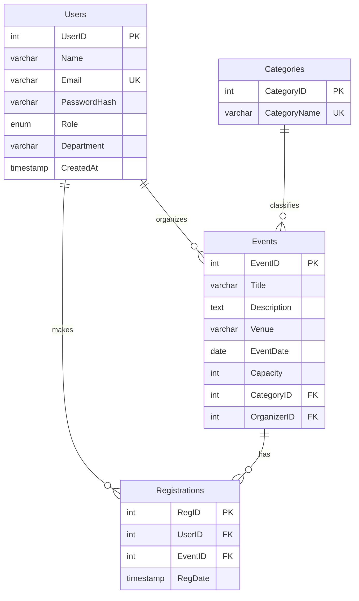

# University Event & Feedback System

A hybrid SQL + NoSQL web application for managing campus events. Event coordinators (Admins) publish events and monitor participation. Students register for events, and after attending they leave ratings and free-form survey answers.

**DBMS Experiential Learning, Level 3 Project** (PES University)
Team: Marella Likhita Sri Durga (PES2UG24CS269) and Medha Vidyananda (PES2UG24CS275)

## Why two databases

| Data | Store | Reason |
|---|---|---|
| Users, roles, events, registrations | **MySQL 8** | Strongly relational, needs foreign keys, uniqueness, transactions and a hard capacity limit. |
| Post-event feedback (rating, comment, tags, survey answers) | **MongoDB** | Each event type asks different survey questions, so documents have variable shape. Aggregation pipelines suit rating analytics. |

## Tech stack

Next.js 14 (App Router, route handlers as the API layer), MySQL 8 (`mysql2`), MongoDB (`mongodb` driver), JWT sessions in an HttpOnly cookie (`jose`), bcrypt password hashing (`bcryptjs`), Recharts.

## Prerequisites

- Node.js 18.17 or newer
- MySQL 8.0 running locally
- MongoDB 6 or newer running locally (or a MongoDB Atlas URI)

## Setup and run

```bash
git clone <your-repo-url>
cd event-feedback-system
npm install

cp .env.example .env        # then edit .env: MySQL password, MongoDB URI, JWT_SECRET
npm run setup               # creates schema, procedure, triggers, Mongo indexes, then seeds mock data
npm run dev                 # http://localhost:3000
```

Keep `MYSQL_DATABASE=EventSystem` (the SQL scripts create and use that name).

Demo logins created by the seed script:

| Role | Email | Password |
|---|---|---|
| Admin | `admin@pesu.example.edu` | `Admin@123` |
| Student | `aarav.1@pesu.example.edu` | `Student@123` |

To run SQL by hand instead: `mysql -u root -p < sql/schema.sql` then `mysql -u root -p < sql/procedures.sql`.

## Features

**Admin:** insights dashboard (MySQL and MongoDB charts), create, edit and delete events, searchable event table, per-event roster, view all feedback.
**Student:** sign up, search and filter events, register or cancel, see seat availability, leave and update feedback for events they attended.

## ER diagram



`EventAuditLog (LogID, EventID, UserID, Action, LoggedAt)` is filled by triggers and has no foreign keys so history survives deletions.

### MongoDB data model (`feedback` collection)

```json
{
  "eventId": 5, "userId": 12, "userName": "Ananya Rao",
  "rating": 4, "comment": "Great speakers.",
  "tags": ["engaging", "well-organised"],
  "survey": { "contentDepth": 4, "handsOnWasUseful": true },
  "submittedAt": "2026-10-20T10:00:00Z"
}
```

Indexes: unique `{eventId, userId}` (one review per student per event), `{eventId, submittedAt}` for listing, text index on `comment`. `survey` is intentionally schema-free. MySQL stays the source of truth for who attended (the API checks `Registrations` before accepting feedback).

## Data dictionary

| Table | Column | Type | Constraints |
|---|---|---|---|
| Users | UserID | INT | PK, auto increment |
| | Name | VARCHAR(100) | NOT NULL, CHECK length >= 2 |
| | Email | VARCHAR(150) | UNIQUE, NOT NULL, CHECK email pattern |
| | PasswordHash | VARCHAR(255) | NOT NULL (bcrypt) |
| | Role | ENUM('Admin','Student') | NOT NULL, default Student |
| | Department | VARCHAR(60) | NULL |
| Categories | CategoryID / CategoryName | INT / VARCHAR(60) | PK / UNIQUE NOT NULL |
| Events | EventID | INT | PK |
| | Title, Venue | VARCHAR | NOT NULL |
| | Description | TEXT | FULLTEXT indexed with Title |
| | EventDate | DATE | NOT NULL, indexed |
| | Capacity | INT | NOT NULL, CHECK > 0 |
| | CategoryID | INT | FK to Categories, RESTRICT |
| | OrganizerID | INT | FK to Users, SET NULL |
| Registrations | RegID | INT | PK |
| | UserID, EventID | INT | FKs, ON DELETE CASCADE, UNIQUE together |
| | RegDate | TIMESTAMP | default current time |

Normalisation: every non-key attribute depends only on its table's key (3NF). Category names live in `Categories` instead of being repeated in `Events`; the many-to-many link between users and events is `Registrations`.

## Advanced database features

1. **Transaction** with row locking: `sp_register_for_event` locks the event row (`SELECT ... FOR UPDATE`), re-checks capacity, duplicates and date, inserts, then commits or rolls back. Two students cannot take the last seat.
2. **Stored procedure and function:** `sp_register_for_event` (OUT status code) and `fn_seats_left(eventId)`.
3. **Triggers:** `trg_registration_capacity` (rejects inserts beyond capacity), `trg_event_capacity_guard` (blocks lowering capacity below current registrations), `trg_registration_audit` and `trg_cancellation_audit` (write to `EventAuditLog`).
4. **Views:** `EventRoster` (roster used by the admin screen) and `EventOccupancy`.
5. **Indexes:** date, category, registration event, plus unique composite `(UserID, EventID)`.
6. **Full-text search:** `MATCH(Title, Description) AGAINST(... IN BOOLEAN MODE)` behind the search box, with LIKE fallback for short words.
7. **NoSQL aggregation:** `$group`, `$match`, `$sort`, `$unwind` pipelines for rating distribution, best-rated events and common tags.
8. **Complex queries:** JOIN + GROUP BY + HAVING + nested subquery (see `sql/queries.sql` and `app/api/analytics/route.js`).

## Security and integrity

- Credentials only from environment variables; `.env` is git-ignored.
- Passwords stored as bcrypt hashes; sessions are signed JWTs in HttpOnly, SameSite cookies.
- All SQL uses parameterised queries; Mongo filters use numeric ids taken from the session.
- Role checks are enforced in every API route (`guard('Admin')` / `guard('Student')`) and the dashboard route is protected by middleware.
- Database-level validation: CHECK, UNIQUE, NOT NULL, FKs, ENUM and triggers. Server-side validation duplicates it for friendly error messages.

## Project structure

```
event-feedback-system/
├── app/
│   ├── api/ (auth, events, registrations, feedback, analytics, categories)
│   ├── dashboard/page.js
│   ├── login/page.js
│   ├── layout.js, page.js, globals.css
├── components/Dashboard.js
├── lib/ (db.js, mongo.js, auth.js, validate.js)
├── scripts/ (init-db.js, seed.js)
├── sql/ (schema.sql, procedures.sql, queries.sql, ddl_demo.sql)
├── docs/ (screenshots go here)
├── middleware.js
├── .env.example, .gitignore, package.json, README.md
```

## Test cases

| # | Scenario | Expected |
|---|---|---|
| 1 | Student registers for an upcoming event with seats | Success toast, seat count increases |
| 2 | Register twice for the same event | "already registered" (procedure check and UNIQUE key) |
| 3 | Register for the 8-seat "Drone Flying Basics" once full | "event is full", button shows Full |
| 4 | `INSERT` into Registrations directly beyond capacity (SQL client) | Error "Event is full" from trigger |
| 5 | Admin lowers capacity below current registrations | Rejected by `trg_event_capacity_guard` |
| 6 | Student calls `POST /api/events` | 403 |
| 7 | Anonymous visit to `/dashboard` | Redirect to `/login` |
| 8 | Student reviews an upcoming event | 403 (not yet attended) |
| 9 | Student submits feedback twice | Single document, updated (unique index) |
| 10 | Search "robot" | Matches Robotics Hands-on Lab |
| 11 | Cancel registration | Row deleted, `EventAuditLog` gets a CANCEL row |
| 12 | Wrong password | Generic "email or password is incorrect" |

## Team contributions

Edit this section to match your commit history (the rubric checks individual commits).

| Member | Responsibility |
|---|---|
| Likhita | MySQL schema, procedure and triggers, registration and event APIs, admin dashboard |
| Medha | MongoDB feedback model and aggregations, authentication, student screens, testing |

## Future enhancements

Email reminders, QR check-in on event day, vector search over feedback comments (pgvector or Atlas Vector Search), CSV export of rosters.
